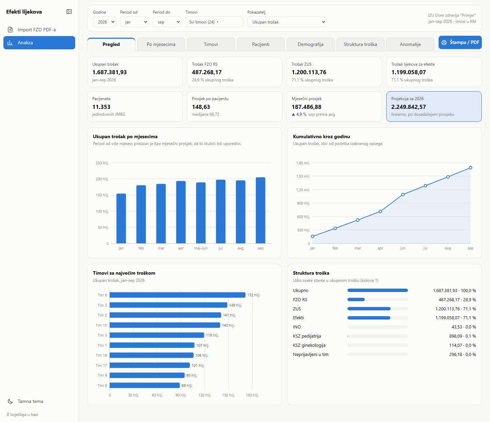

# Efekti lijekova

Lokalna web aplikacija za analizu troška propisanih lijekova u domu zdravlja. Uvozi izvještaje Fonda zdravstvenog osiguranja Republike Srpske (FZO RS) *„Pregled propisanih lijekova po zdravstvenim ustanovama i timovima"* u PDF formatu, izvlači sve podatke u JSON i prikazuje analize po mjesecima, timovima, pacijentima i starosnim grupama, sa grafikonima, tabelama, izvozom u Excel i izvještajem za štampu / PDF.

Aplikacija radi samo na računaru na kome je pokrenuta (`127.0.0.1`). Podaci o pacijentima ne napuštaju računar i ne ulaze u git.



> Svi podaci na slikama su izmišljeni: JMBG-ovi, nazivi ustanove i timova i iznosi su generisani i ne odgovaraju stvarnim pacijentima ni ustanovi.

## Mogućnosti

- **Import PDF-a**: jedan ili više FZO RS izvještaja odjednom (prevlačenjem ili iz foldera `data-pdf`). Period, ustanova, timovi i kolone čitaju se iz samog PDF-a, pa aplikacija radi i sa budućim izvještajima, novim timovima i novim godinama.
- **Kontrola ispravnosti** svakog izvještaja: zbir pacijenata = zbir tima, zbir timova = ukupno ustanove, formule kolona (1 = 2 + 3, 3 = 3a + 3b + 3c + 3d).
- **Praćenje po mjesecima**: izvještaji FZO RS su kumulativni (od 1. januara), pa se iznos za svaki mjesec računa kao razlika dva uzastopna izvještaja. Nedostajući mjeseci se spajaju u jedan period.
- **Analize**:
  - *Pregled*: ukupan trošak, FZO RS / ZUS, broj pacijenata, prosjek, mjesečni trend, projekcija za godinu.
  - *Po mjesecima*: FZO RS i ZUS po mjesecima, broj (novih) pacijenata, poređenje godina.
  - *Timovi*: rang lista, trošak po pacijentu, toplotna mapa tim × mjesec, kretanje po timovima.
  - *Pacijenti*: raspodjela troška, koncentracija (najskupljih 1/5/10/20 %), istorija pojedinačnog pacijenta.
  - *Demografija*: trošak po starosti i polu (iz JMBG-a), demografija po timovima.
  - *Struktura troška*: odnos FZO RS i ZUS po timovima i kroz vrijeme.
  - *Anomalije*: storna i korekcije, pacijenti koji su nestali iz tima, pacijenti u više timova, posebni JMB (INO osiguranici, privremeni brojevi) i neispravni JMBG.
- **Filteri**: godina, period od–do, izbor timova, pokazatelj (bilo koja kolona izvještaja).
- **Izvoz** svake tabele u Excel ili CSV.
- **Izvještaj za štampu / PDF**: A4, naslov, automatski generisana tekstualna analiza, grafikoni i tabelarni prilog; izbor analiza koje ulaze u izvještaj.
- Svijetla i tamna tema.

## Pokretanje (Windows)

Potreban je samo [Python 3.10+](https://www.python.org/downloads/) (pri instalaciji označite *Add python.exe to PATH*). Za dugme *Sačuvaj PDF* potreban je Microsoft Edge ili Google Chrome (na Windowsu je Edge već instaliran).

1. Preuzmite projekat (`git clone` ili *Code → Download ZIP*).
2. Pokrenite **`start.bat`**.

Prvi put `start.bat` napravi Python okruženje (`.venv`) i instalira pakete (minut-dva, potreban je internet). Svaki sljedeći put samo pokrene aplikaciju i otvori je u browseru na `http://127.0.0.1:8000`. Server se sam ugasi kad zatvorite karticu aplikacije u browseru.

Interfejs je već izgrađen u `frontend/dist`, pa Node.js nije potreban.

## Gdje su podaci

| Folder | Sadržaj |
|---|---|
| `data-pdf/` | originalni PDF izvještaji (opciono, za uvoz cijelog foldera odjednom) |
| `data-json/` | izvučeni podaci, jedan JSON fajl po izvještaju |

Oba foldera su u `.gitignore` jer sadrže podatke o pacijentima. Za prenos podataka na drugi računar dovoljno je kopirati folder `data-json`.

## Razvoj

```
backend/    FastAPI server (main.py) i ekstrakcija PDF-a (extractor.py, PyMuPDF)
frontend/   React + TypeScript + Vite + ECharts
```

Interfejs u razvojnom režimu (sa automatskim osvježavanjem; server mora raditi na portu 8000):

```bash
cd frontend
npm install
npm run dev
```

Nakon izmjena u `frontend/src` izgradite interfejs ponovo i komitujte i `frontend/dist`:

```bash
cd frontend
npm run build
```
